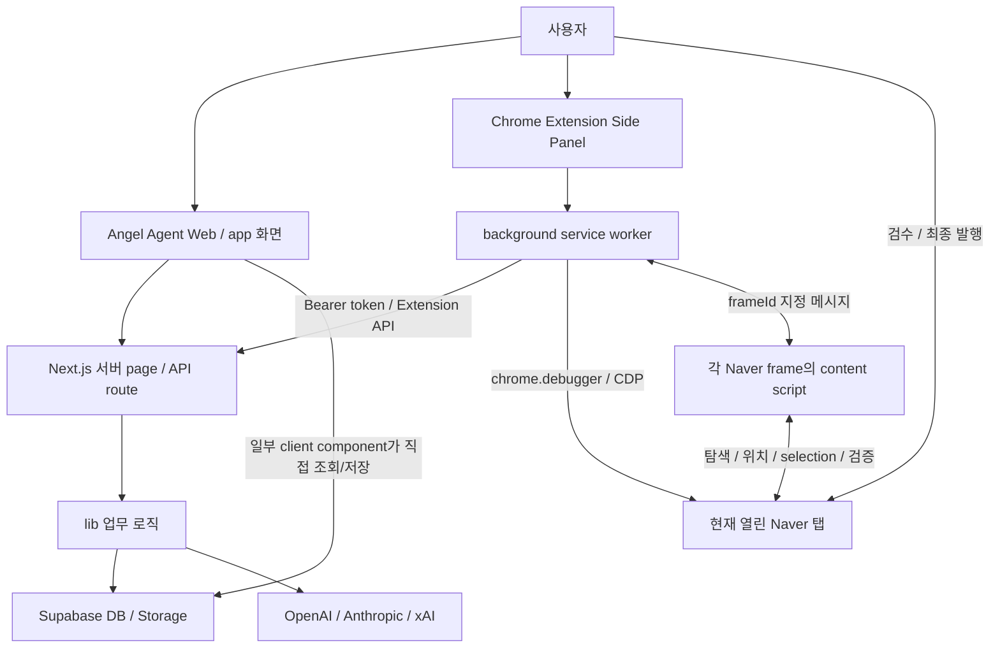
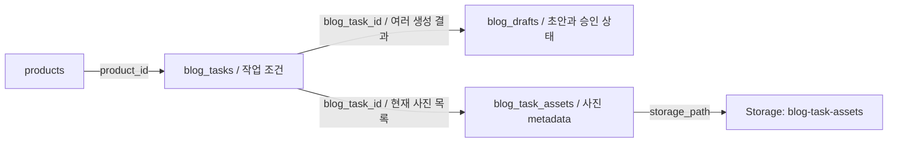

# ANGEL AGENT 코드 구조와 기능 변경 안내

기준일: 2026-10-14. 작성 브랜치: `chore/blog-cleanup`.

이 문서는 현재 저장소의 import, 함수 호출, Supabase 조회/저장, Extension 메시지 흐름을 기준으로 작성했다. 문서 작성 중 실제 DB 조회, AI 생성, Chrome/Naver 실행은 하지 않았다. 실제 운영 검증에 관한 설명은 기존 `extension/README.md`의 사용자 검증 기록과 구분해서 적었다. 아래의 **향후 설계**는 현재 구현이 아니다.

## 1. 전체 프로젝트 구조

| 위치 | 역할 | 처음 볼 파일 |
|---|---|---|
| `app/` | Next.js App Router. `page.tsx`는 화면, `route.ts`는 HTTP API, client component는 사용자 이벤트를 처리한다. | `app/layout.tsx`, `app/content/blog/[id]/page.tsx` |
| `app/products/` | 제품 등록/편집, 제품 사진, 리뷰 업로드, VOC 실행 화면 | `app/products/[id]/page.tsx` |
| `app/content/blog/` | Blog Task 생성/수정, AI 초안 생성/편집/승인, 사진 등록, 수동 발행 준비 | `app/content/blog/new/page.tsx`, `app/content/blog/[id]/GenerateBlogDraft.tsx` |
| `app/content/kin/` | 지식인 답변 생성, preset 선택/관리, 최근 작업 화면 | `app/content/kin/page.tsx`, `KinAnswerForm.tsx`, `KinPresetControl.tsx` |
| `app/api/` | Blog/지식인 생성, 리뷰 import, VOC 분석, Extension 자료·임시 사진 API | `app/api/blog/generate/route.ts` |
| `lib/` | UI와 외부 I/O 사이의 업무 로직. Prompt, schema, provider transport, 사진 배치/블록 변환, 파일 처리 등이 있다. | `lib/blog-generation/`, `lib/blog-publishing/`, `lib/ai/provider.ts` |
| `extension/` | Chrome Manifest V3 확장프로그램. 웹 앱과 별도로 빌드하고 Chrome에 설치한다. | `manifest.json`, `sidepanel/index.ts`, `background.ts`, `content.ts` |
| `supabase/migrations/` | DB 테이블/정책/Storage bucket 등 SQL 변경 기록. 현재 전체 DB를 처음부터 생성하는 완전한 schema dump는 아니다. | `202610100001_create_blog_task_assets.sql` |
| `scripts/` | 로컬 회귀 테스트와 Extension 빌드. Next.js 요청 처리 경로는 아니다. | `test-blog-body.ts`, `test-extension-api.mjs`, `test-extension-blocks.mjs`, `build-extension.mjs` |
| `docs/` | 구현 방향, 사용 안내, 작성 가이드, 현재 구조에 대한 설명 | `ROADMAP.md`, `AI_GENERATION.md`, 이 문서 |

`app/layout.tsx`에서 실제 메뉴 링크를 확인할 수 있다. Sourcing/Ads/Sales/Settings처럼 `<span>`으로 표시한 메뉴는 해당 링크가 구현된 기능과 구분해야 한다.

### 생성물과 설정 파일

- `.next/`: Next.js 빌드/개발 캐시. 구조를 공부하거나 기능을 수정할 곳이 아니다.
- `node_modules/`: 설치된 라이브러리. 일반 기능 변경은 이곳을 편집하지 않는다.
- `extension/dist/`: `scripts/build-extension.mjs`가 만드는 Chrome 로딩용 JS/HTML/CSS. 수정 대상은 `extension/*.ts`, `extension/sidepanel/*` 원본이다.
- `*.tsbuildinfo`: TypeScript 캐시.
- `.env.local`: 환경 설정/비밀값. 이 문서에는 값이 아닌 변수 이름만 설명한다.
- `package.json`: Next.js 실행·검사와 `build:extension` 명령. `tsconfig.json`, `extension/tsconfig.json`은 각각 앱과 확장프로그램 타입 검사 설정이다.

## 2. 전체 시스템 아키텍처



이 시스템은 모든 기능이 `UI → API → lib`를 거치는 구조는 아니다. 작업 생성, 작업 정보 수정, draft 편집/승인, 사진 업로드는 client component가 `lib/supabase.ts`의 client로 직접 DB/Storage에 접근한다. AI 생성, Extension 전용 자료 조회, 임시 사진 생성은 서버 API를 거친다.

### 외부 서비스 경계

| 연결 | 실제 담당 코드 | 설정/특성 |
|---|---|---|
| Supabase | `lib/supabase.ts` | `NEXT_PUBLIC_SUPABASE_URL`, `NEXT_PUBLIC_SUPABASE_PUBLISHABLE_KEY`. client/server 양쪽에서 import하므로 DB 권한은 RLS/정책에 달려 있다. |
| Blog/KIN AI 호출 | `lib/ai/provider.ts` | `OPENAI_API_KEY`, `ANTHROPIC_API_KEY`, `XAI_API_KEY`. 서버 호출용 transport. |
| Extension → 앱 API | `lib/blog-publishing/extension-api.ts`, `extension/background.ts` | `ANGEL_EXTENSION_TOKEN` 32자 이상, Bearer 인증. 앱 주소/토큰은 Chrome local storage에 저장하고 `TRUSTED_CONTEXTS`로 접근을 제한한다. |
| Extension → Naver | `extension/background.ts`, `extension/content.ts` | 사용자가 이미 열고 로그인한 탭. Chrome 실행, 별도 profile, ID/PW 자동 로그인 없음. Playwright/Selenium/Puppeteer 경로 없음. |

제품/VOC/지식인도 같은 앱에 있다. 리뷰는 `app/api/products/[id]/reviews/import/route.ts → lib/reviews/import.ts`, VOC는 `app/api/products/[id]/voc/analyze/route.ts → lib/voc/analyze.ts`로 이어진다. VOC는 자체 OpenAI 호출을 사용한다. KIN은 `app/api/kin/generate/route.ts → lib/kin/provider.ts → lib/ai/provider.ts`로 공통 transport를 재사용하고, `lib/kin/generate.ts`, `presets.ts`, `quality-check.ts`가 KIN 규칙을 담당한다. KIN route는 완료된 VOC를 참고하지만 현재 Blog generate route는 제품 정보만 조회한다.

## 3. 블로그 기능 전체 흐름

| 단계 | 실제 파일/함수 | 데이터가 이동하는 방식 |
|---|---|---|
| 작업 생성 | `app/content/blog/new/page.tsx: handleSubmit()` | 제품 선택, keyword/topic/instructions → `blog_tasks.insert`, status=`pending` |
| 작업 조회/수정 | `app/content/blog/[id]/page.tsx`, `EditBlogTask.tsx: saveTask()` | 작업·제품·최신 draft·Task 사진 조회. 작업 조건 수정은 기존 draft를 바꾸지 않는다. |
| AI 초안 요청 | `GenerateBlogDraft.tsx: generateDraft()` | `{ taskId, provider, model }` → `POST /api/blog/generate` |
| 생성/저장 | `app/api/blog/generate/route.ts: POST()` | Task/제품 조회 → prompt → 공통 provider → JSON/schema 검증 → `blog_drafts.insert` → Task status=`generated` |
| 편집/승인 | `GenerateBlogDraft.tsx: saveDraft()/changeStatus()` | 제목/intro/sections/closing 수정 또는 status=`draft/approved/rejected`를 DB에 직접 저장 |
| 사진 저장 | `BlogTaskAssets.tsx: upload()`, `lib/blog-task-assets/compact.ts` | 파일 선택 → 이미지 축소/WebP 압축 후보 → Storage upload → `blog_task_assets.insert` |
| 사진 정렬/배치 | `downloads.ts: orderedTaskImages()`, `image-layout.ts: planBlogImages()` | `sort_order ASC → id ASC` 사진 목록과 draft로 문단 분할/사진 경계 계산 |
| 발행용 텍스트 준비 | `preparation.ts: prepareBlogPost()` | draft와 사진 수 → 본문, 계획 문단, 사진 offsets, 수동 사진 마커 |
| 실행 blocks 생성 | `blocks.ts: createBlogExecutionBlocks()` | 실행 본문 + offset이 있는 사진 → 순서대로 text/image blocks |
| Extension 자료 API | `extension-api.ts: getExtensionBlogTask()` | 승인 draft + 현재 Task 사진 + signed URLs + blocks 반환 |
| Side Panel 선택 | `extension/sidepanel/index.ts: loadTasks()/loadSelectedTask()` | 승인 draft 목록에서 Task/draftId를 선택. 입력 직전 동일 draftId 재조회 |
| Chrome 실행 | `extension/background.ts: insertWithDebugger()` | 현재 Naver 탭의 frame 확정 → debugger attach → 제목 입력 → 기본 V3 blocks 실행 |
| DOM 위치/검증 | `extension/content.ts: inspect()/blockRequest()/photoRequest()` | 제목·본문·사진 버튼 탐색, 현재 문서 끝 selection, 텍스트·이미지 위치/count 검증 |
| 종료 | `background.ts`의 `finally` | 임시 사진 정리, file chooser interception 해제, debugger detach. 입력한 Naver 탭은 그대로 둔다. |
| 최종 발행 | 사용자 | Naver에서 결과를 검수하고 발행/예약을 직접 수행한다. |

사진 저장은 AI 생성 전에도 가능하다. 위 표는 책임을 설명하는 순서이며 UI에서 강제하는 단일 작업 순서는 아니다.

### 수동 준비 화면은 별도의 fallback

`app/content/blog/publishing/page.tsx`는 **승인된 draft 목록**이다. background worker가 처리하는 Publishing Queue가 아니다.

`app/content/blog/[id]/prepare/page.tsx`는 taskId와 선택적 draftId를 읽고 `PreparationPanel.tsx`에 자료를 전달한다. 이 화면에서는 제목/본문 복사, 사진 미리보기, 번호별 다운로드/ZIP 다운로드가 가능하다. `prepareBlogPost()`의 `bodyWithMarkers`를 선택적으로 복사하며 **Extension을 직접 실행하지 않는다**. `/prepare`는 검수 전 draft도 볼 수 있지만 Extension API는 승인 draft만 허용한다.

## 4. 블로그 주요 데이터 모델



이 그림은 코드의 조회/저장 관계다. `blog_task_assets.blog_task_id`의 FK와 `ON DELETE CASCADE`는 migration에서 확인했다. `blog_tasks`/`blog_drafts` 최초 생성 SQL은 현재 migrations에 없으므로 모든 실제 DB constraint를 이 문서가 보증하지는 않는다.

| 테이블 | 왜 존재하는가 / 코드에서 사용하는 주요 필드 | 읽고 쓰는 코드 |
|---|---|---|
| `blog_tasks` | 생성 작업의 입력 조건. `id`, `product_id`, `keyword`, `topic`, `instructions`, `status`, `created_at`. 하나의 작업에서 여러 draft를 생성할 수 있다. | `new/page.tsx` 생성, `EditBlogTask.tsx` 수정, 목록/상세 page 조회, generate route 조회·status 갱신, Extension API 조회, task DELETE route 삭제 |
| `blog_drafts` | AI 생성 결과와 사용자 검수 결과. `id`, `blog_task_id`, `product_id`, `title`, `intro`, `sections`, `closing`, `status`, `model`, `created_at`. | generate route insert, `GenerateBlogDraft.tsx` edit/status update, 상세/prepare/publishing page 및 Extension API read |
| `blog_task_assets` | Task에 사용할 파일 목록과 정렬 순서. `id`, `blog_task_id`, `storage_path`, `file_name`, `sort_order`, `created_at`. 실제 이미지 bytes는 Storage에 있다. | `BlogTaskAssets.tsx` upload metadata insert, 상세/prepare/Extension API read, `lib/blog-task-assets/delete.ts` 전체 삭제 |

### 혼동하기 쉬운 데이터 구분

- **Task 사진은 draft별 snapshot이 아니다.** Draft 14를 선택하더라도 사진은 그 시점의 Task 9 사진을 읽는다. 이후 사진 목록을 변경하면 같은 draftId의 Extension 응답도 바뀔 수 있다.
- `products`에 붙는 `product_assets`와 Blog Task에 붙는 `blog_task_assets`는 별개다. 현재 Extension 사진 경로는 후자를 사용한다.
- AI schema의 `sections[].imageAssetId`는 `null`이다. 현재 실제 사진 배치는 이 필드가 아니라 Task 사진 순서와 `planBlogImages()`로 결정한다.
- `purpose`는 Blog 목록에서 읽고 표시하지만 현재 생성/수정 폼, generate route 조회, prompt에는 들어가지 않는다. 현재 작업별 생성 입력은 `keyword/topic/instructions`다.
- draft의 `status`는 검수 상태다. 역사적 `publishing_status`와 별개다. Extension 입력/prepare 경로는 `queued/publishing/ready_for_review/published`로 DB 상태를 갱신하지 않는다.
- 생성 결과의 실제 `model`은 DB에 저장된다. provider는 응답에서 전달하며 UI 재조회 시에는 모델 prefix로 추정한다. 현재 generate insert에 provider 전용 컬럼 저장은 없다.
- `saveDraft()`는 승인된 초안을 편집해도 status를 자동으로 `draft`로 되돌리지 않는다. 승인 후 변경의 재승인 정책은 후속 과제다.

사진 metadata 테이블과 private bucket의 정의는 `supabase/migrations/202610100001_create_blog_task_assets.sql`에 있다. publishable client가 접근 가능한 anon/authenticated 정책을 포함하므로 기존 내부 개발 권한 모델과 구분 없이 외부 서비스용 인증이 완성되었다고 보면 안 된다.

## 5. 블로그 생성 코드: 입력 → 처리 → 출력

| 파일 | 입력 | 처리 | 출력 / 호출자 |
|---|---|---|---|
| `lib/blog-generation/prompts.ts` | 제품 name/brand/usp/target_customer/customer_problem/notes + Task keyword/topic/instructions | `BLOG_FIXED_INSTRUCTIONS`, `BLOG_CONTENT_STRATEGY_GUIDE`, `BLOG_COPYWRITING_SKILLS_GUIDE`를 분리하고 `buildBlogPrompt()`에서 조립 | `{ systemInstructions, input }`. input은 상품·task·참고 가이드·분량 가이드를 담은 JSON 문자열. generate route가 사용 |
| `lib/blog-generation/schema.ts` | 생성 결과 unknown JSON | `DRAFT_SCHEMA`로 AI 출력 계약 지정, `isDraft()`로 응답을 runtime 검사 | title/intro/sections/closing. 각 section은 heading/body/imageAssetId=`null`. sections 최소 1개 |
| `lib/blog-generation/models.ts` | provider와 선택적 model | `BLOG_MODEL_OPTIONS`, `BLOG_DEFAULT_MODELS`, `resolveBlogModel()`로 기본값/허용 목록 판단 | 유효 model 또는 `null`. UI와 route가 같은 목록 사용 |
| `lib/blog-generation/body.ts` | intro/section heading·body/closing | `checkBlogBodyLength()`가 제목과 줄바꿈을 제외하고 Unicode 문자 수 계산 | characters와 too_short/ok/too_long. 목표 1,500자, 안내 범위 1,200~1,800자 |
| `app/api/blog/generate/route.ts` | POST `{taskId, provider?, model?}` | 요청/키 검증 → Task/제품 DB 조회 → prompt 조립 → provider → JSON parse/schema 검증 → draft 저장 → Task status 갱신 | draftId, draft, bodyLength, 실제 provider/model 또는 HTTP 오류 |
| `lib/ai/provider.ts` | provider/model/schema/schemaName/systemInstructions/input 및 선택적 token/reasoning 옵션 | OpenAI Responses, Anthropic Messages structured output, xAI OpenAI-compatible Chat Completions | `{outputText, provider, model}`. refusal/incomplete/출력 없음은 `ProviderOutputError` |

분량 검사는 현재 안내·표시 목적이다. schema 검증을 통과한 글을 글자 수만으로 저장 거부하는 hard gate는 아니다. route는 draft 저장 후 Task 상태를 따로 갱신하므로, Task 갱신 실패 시 draft는 이미 저장되었을 수 있다는 오류를 반환한다. 하나의 DB transaction으로 묶인 작업이 아니다.

`docs/CONTENT_STRATEGY.md`/`COPYWRITING_SKILLS.md`를 수정한다고 prompt가 자동으로 바뀌지는 않는다. 현재 runtime은 Markdown 파일을 읽지 않고 `prompts.ts`의 상수를 사용한다. 고정 사실성 규칙은 참고 가이드보다 우선하며, 작업 지시도 고정 사실성 규칙을 우회하는 수단이 아니다.

## 6. 블로그 발행 준비와 text/image blocks

### 네 모듈의 연결

```text
승인 draft + 정렬된 Task 사진
  → extension-api.ts:getExtensionBlogTask()
     → preparation.ts:prepareBlogPost(draft, imageCount)
        → image-layout.ts:planBlogImages()
           → splitParagraph() / getBlogParagraphs() / chooseImagePositions()
        ← 계획 draft + beforeParagraphs
     ← executionBodyText + imageInsertOffsets + 수동 blocks/marker 문자열
     → Storage.createSignedUrl(path, 600)
     → blocks.ts:createBlogExecutionBlocks(executionBodyText, signedImages)
  ← {id, draftId, status, title, paragraphs, bodyText, images, blocks}
```

### `image-layout.ts`: 사진 위치 정책

상단 `IMAGE_PLACEMENT_RULE`의 현재 설정은 `strategy: "even"`, `allowParagraphSplit: true`다.

- `splitParagraph()`는 문장부호 경계를 우선하고 없으면 공백 경계로 긴 prose를 나눈다.
- `getBlogParagraphs()`는 intro/heading/body/closing을 줄별로 정리하고 prose 여부를 표시한다.
- `chooseImagePositions()`는 사진을 넣을 **문단 앞 index**를 결정한다. heading 뒤 경계는 제외하고 마지막 문단 뒤도 제외한다. 부족한 경계에서는 여러 사진이 같은 경계를 사용할 수 있다.
- `planBlogImages()`는 필요한 prose 분할을 수행하고 계획 draft와 `beforeParagraphs`를 반환한다. 원본 DB draft를 수정하는 함수가 아니다.

여기서 prose에는 intro/section body/closing이 포함된다. 현재 정책이 언제나 “section 1 body 뒤부터 사진 시작”이라고 가정하면 안 된다. 배치 규칙을 바꿀 곳은 `chooseImagePositions()`다.

### `preparation.ts`: 두 가지 소비자를 위한 결과

`prepareBlogPost()`는 계획된 문단으로 두 결과를 만든다.

1. 수동 화면: `PreparationBlock = text 또는 {type:"image", imageIndex}`와 `bodyWithMarkers`.
2. Extension: 마커 없는 `executionBodyText`, 그 문자열 기준 `imageInsertOffsets`.

`composeBlogBody()`의 `body`는 원래 draft를 조립한 수동 마커 없는 본문이다. 계획 draft가 prose를 나눴을 수 있으므로 `executionBodyText`와 줄 구성이 다를 수 있다.

### `blocks.ts`: 실행용 데이터 계약

`createBlogExecutionBlocks()`는 offset을 따라 bodyText를 slice하고 그 사이에 이미지 metadata를 넣는다. 사진 위치를 새로 계산하지 않는다. offset이 역순/범위 밖/중복 image index/Unicode surrogate pair 중간이면 오류를 발생시킨다.

예를 들어 이미 배치 계산을 마친 가상의 자료가 다음과 같다고 하자. **실제 Task 9의 원문이나 사진 위치를 재현한 값은 아니다.**

```ts
bodyText = "AAA\n\nBBB\n\nCCC";
images = [
  { index: 0, insertOffset: 3, signedUrl: "<URL 0>" },
  { index: 1, insertOffset: 8, signedUrl: "<URL 1>" },
];

blocks = [
  { type: "text", text: "AAA" },
  { type: "image", index: 0, insertOffset: 3, signedUrl: "<URL 0>" },
  { type: "text", text: "\n\nBBB" },
  { type: "image", index: 1, insertOffset: 8, signedUrl: "<URL 1>" },
  { type: "text", text: "\n\nCCC" },
];
```

text block만 이어 붙이면 반드시 `bodyText`와 같아야 한다. 동일 offset에 여러 사진이 있으면 image block이 연속으로 나온다. 기본 V3는 이 blocks 순서를 그대로 실행한다. Extension API는 현재 `imageMarkers`/마커 본문을 반환하지 않는다. 사진 마커는 수동 준비 화면에 남아 있고, Extension은 실제 이미지 metadata를 사용한다.

## 7. Extension 구조와 실행 경계

| 파일 | 책임 | 하지 않는 일 |
|---|---|---|
| `sidepanel/index.ts` + HTML/CSS | 연결 설정, 승인 draft 목록/선택, 선택 race 방지, DOM 진단 표시, 기존 글 덮어쓰기 확인, publisher 선택, INSERT 메시지 | CDP나 Supabase 직접 호출 |
| `background.ts` | 앱 API 호출, 현재 active Naver 탭/frame 확정, debugger lifecycle, CDP mouse/key/text/file input, 임시 이미지 cleanup, 실행 stage/error 관리 | 제품별 prompt 작성, 사진 위치 재계산, 최종 발행 |
| `content.ts` | `PostWriteForm.naver`/제목/본문 DOM 탐색, 좌표 변환, 현재 본문 끝 selection 및 이미지 삽입 위치 준비, 텍스트/count/order 검증 | API token 처리, 파일 다운로드, CDP 전송, DOM에 본문을 직접 대입 |
| `types.d.ts` | `ExtensionTask`, `ExtensionMessage`, `ExtensionReply`, 진단/좌표와 사용 Chrome API의 TypeScript 계약 | runtime 검증이나 실행 코드 |
| `manifest.json` | MV3 service worker, side panel, Naver all_frames content scripts와 debugger/storage/webNavigation 권한 | Chrome 새 창/profile 생성 |

### 메시지를 따라 읽기

`TASKS` → background가 승인 목록 API 호출. `TASK` → taskId/draftId 상세 API 호출. `DIAGNOSE` → background가 Naver frame마다 `EDITOR_DIAGNOSE`를 요청. `INSERT` → background가 선택한 frame에 위치/검증 메시지를 보내며 CDP를 실행한다.

현재 ready는 `frameReady && titleFound && bodyFound`다. contenteditable 속성이 없다는 이유로 거부하지 않는다. 입력 가능 여부는 CDP 실행 후 실제 DOM 검증으로 판단한다.

### 기본 V3 (`publisher: "blocks"`)

Side Panel HTML의 기본 선택은 `V3 순차 입력`이다. `background.ts`의 함수 인자 기본값은 legacy이지만 Side Panel이 명시적으로 `blocks`를 보내므로 실제 UI 기본 경로는 V3다.

```text
debugger attach
 → 기존 insertField("title")로 제목 클릭·Input.insertText·검증
 → blocks 계약 검증 / 빈 본문 시작
 → text block: 현재 tail caret 확인 → Input.insertText → 누적 본문 검증 → 끝 selection 정리
 → image block: 임시 파일 생성 → Enter/빈 삽입 문단 준비
                → 사진 버튼 클릭 → 현재 file input 조회 → DOM.setFileInputFiles
                → 이미지 증가/배치·본문 보존 검증 → 다음 tail 준비
 → 다음 block ...
 → 전체 본문 및 이미지 count 검증
 → finally: interception 해제 / 임시파일 삭제 재시도 / debugger detach
 → 사용자가 결과 확인 및 최종 발행
```

실제 텍스트 입력은 `Input.insertText`, 클릭/key/file 입력은 CDP다. V3의 content script에는 tail의 DOM Range/Selection을 준비·검증하는 코드도 있다. “content는 DOM을 읽기만 한다”거나 “현재 V3가 본문 전체를 한 번에 넣는다”는 설명은 정확하지 않다.

V3 사진은 file chooser 이벤트를 기다리기보다 `DOM.getDocument`로 Naver file input을 다시 찾아 `DOM.setFileInputFiles`에 파일을 전달한다. native chooser interception은 loop 동안 유지한다. 사진 검증은 DOM component 증가, 이전 이미지 유지, 앞 텍스트 경계 등을 검사하지만 사진 bytes 자체를 대조하는 동일성 검증은 아니다.

### legacy (`publisher: "legacy"`)

본문 전체를 먼저 넣고 `task.images.slice(0, 3)`만 사용한다. offset이 큰 사진부터 역순으로 과거 위치에 삽입한다. `insertPrefix`와 offset을 사용하는 `photoRequest()`와 chooser 이벤트 interception 경로가 남아 있다. V3 전체 사진 경로와 이 최대 3장 fallback을 혼동하지 않는다.

### 임시 파일 경로는 배포 제약이다

`POST /api/extension/temp-image → lib/blog-publishing/temp-image.ts:createTempImage()`가 허용된 Supabase signed URL을 다운로드하고 PNG/JPEG/WebP 형식·10MB 제한을 검사한다. 서버 `os.tmpdir()/angel-agent/naver-upload/` 아래에 파일을 만들고 `{tempId, absolutePath}`를 반환한다. background가 이 경로를 Chrome에 전달한다.

따라서 **현재 사진 입력은 Next.js 서버의 파일 경로가 Chrome 실행 머신에서도 접근 가능해야 한다.** 원격 HTTPS 앱 주소를 설정할 수 있다는 사실만으로 원격 서버 이미지가 로컬 Chrome에 자동 전달되는 구조는 아니다. 로컬 앱/Chrome 환경과 원격 배포를 구분해야 한다.

작업 종료 시 `DELETE /api/extension/temp-image/{tempId}`를 재시도한다. 브라우저/worker/서버 강제 종료까지 보장하는 영속 cleanup worker는 없다. 현재 연결 토큰은 과거 session storage 방식이 아니라 `chrome.storage.local`의 `appUrl/extensionToken`을 사용한다.

## 8. Task 9 / Draft 14 / 사진 10장 실행 예시

아래는 **Task 9에 승인 Draft 14와 사진 10장이 존재한다고 가정한 현재 코드 실행 예시**다. 이번 문서 작성에서 이 ID의 실제 행/본문/사진을 조회하지 않았다.

1. 앱의 `GenerateBlogDraft.tsx`에서 Draft 14를 승인한다. 사진은 `BlogTaskAssets.tsx`가 Task 9에 저장한 목록이다.
2. Side Panel `loadTasks()` → background `TASKS` → `GET /api/extension/blog-tasks`. 목록 API는 작업별 최신 승인 draft를 고른다. Task 9의 최신 승인 draft가 14일 때 `{id:9,draftId:14,...}`가 나온다. 다른 승인 draft가 더 최신이면 UI는 그 draftId를 선택하므로 14가 고정되는 것은 아니다.
3. 선택 시 `TASK {id:"9",draftId:"14"}` → `GET /api/extension/blog-tasks/9?draftId=14`. 서버는 `blog_task_id=9 AND id=14`로 찾고 approved인지 다시 확인한다.
4. `getExtensionBlogTask()`가 Task 9의 `blog_task_assets` 10장을 정렬한다. `prepareBlogPost(draft,10)`가 문단/offset을 계획하고, signed URL 10개와 `createBlogExecutionBlocks()`의 text/image blocks를 만든다. 사진 index는 0~9다.
5. 응답은 `{id:9,draftId:14,status:"approved",title,paragraphs,bodyText,images:[10개],blocks}`. `bodyText`에는 사진 마커가 없다. text blocks의 연결은 이 본문과 같고 image blocks는 10개여야 한다.
6. 입력 버튼 클릭 시 Side Panel은 **같은 draftId=14를 재조회**한다. taskId/draftId/approved 상태와 선택 변경 여부를 검사한 뒤 `INSERT {task,publisher:"blocks",overwrite}`를 보낸다.
7. background는 active Naver 탭의 PostWriteForm frame을 찾고 attach한다. 제목 입력 후 blocks 순서대로 본문·사진을 넣는다. 각 사진마다 temp API → 서버 파일 → CDP file input으로 전달된다.
8. content script는 누적 본문, 사진 삽입 경계/증가, 마지막 본문·사진 수를 확인한다. background는 임시파일 정리 및 detach 후 “입력 완료 - 네이버에서 직접 확인 후 발행하세요”를 반환한다.
9. 이 결과가 DB에 발행 완료로 자동 기록되지는 않는다. Naver의 실제 발행 버튼은 사용자가 누른다.

수동 경로라면 `/content/blog/9/prepare?draftId=14`에서 복사/다운로드한다. 해당 page는 Extension blocks API를 호출하는 것이 아니라 DB를 직접 읽어 `PreparationPanel`을 렌더링한다.

## 9. 이걸 바꾸려면 어디를 봐야 하나

| 바꾸려는 것 | 먼저 볼 코드 | 같이 확인할 경계 |
|---|---|---|
| 글 문체/후킹/사실성 규칙 | `lib/blog-generation/prompts.ts` | Markdown 문서를 runtime에 자동 로딩하지 않음 |
| AI JSON 출력 구조 | `lib/blog-generation/schema.ts` | generate route 저장 필드, `GenerateBlogDraft.tsx`, preparation/Extension parser |
| provider transport/오류 처리 | `lib/ai/provider.ts` | Blog와 KIN 공통 사용, VOC는 자체 호출 |
| Blog 모델 목록/기본값 | `lib/blog-generation/models.ts` | UI selector와 API 허용 모델이 함께 사용 |
| 생성 요청·DB 저장·Task 상태 | `app/api/blog/generate/route.ts` | draft 저장과 Task update의 부분 실패 |
| 목표 글자 수 | `lib/blog-generation/body.ts` | prompts.ts, GenerateBlogDraft.tsx 표시 |
| Task 입력/수정 필드 | `new/page.tsx`, `[id]/EditBlogTask.tsx` | generate route select와 prompt task payload |
| 초안 편집/승인 정책 | `[id]/GenerateBlogDraft.tsx` | Extension approved-only 검사, 승인 후 편집 정책 |
| 기본 사진 배치 | `lib/blog-publishing/image-layout.ts` | `chooseImagePositions()` / prose 분할, beforeParagraphs |
| 문단 조립/수동 marker/offset 계산 | `lib/blog-publishing/preparation.ts` | body와 executionBodyText의 차이 |
| text/image 실행 순서/계약 | `lib/blog-publishing/blocks.ts` | 위치 정책 자체는 image-layout.ts, 실제 실행은 background loop |
| Extension 응답/승인 draft 선택 | `lib/blog-publishing/extension-api.ts`, `app/api/extension/blog-tasks/*` | taskId/draftId와 현재 사진 목록, signed URL 만료 |
| Naver 실제 입력/CDP lifecycle | `extension/background.ts` | `content.ts` 메시지 계약, blocks/legacy 분기 |
| Naver DOM selector/caret/검증 | `extension/content.ts` | 구조 변경과 background 요청/응답, 이미지 순서 검증 |
| Side Panel UI/선택 race/연결 설정 | `extension/sidepanel/` | `types.d.ts`, background API 연결 |
| Extension 권한/빌드 | `extension/manifest.json`, `scripts/build-extension.mjs` | dist는 생성물, Next.js build와 별도 |
| 사진 업로드·선택 파일 목록 | `[id]/BlogTaskAssets.tsx` | Storage upload + DB metadata 저장의 부분 실패 |
| 사진 축소/압축 | `lib/blog-task-assets/compact.ts`, `lib/blog-task-assets.ts` | 1800px 크기 계산, WebP quality 0.82, 더 작을 때 사용 |
| 사진 전체 삭제/파일 복원 | `lib/blog-task-assets/delete.ts` | Storage 파일과 DB row의 일관성 |
| 수동 복사/사진 ZIP | `[id]/prepare/PreparationPanel.tsx`, `downloads.ts` | `orderedTaskImages`, 번호/확장자/ZIP CRC |
| CDP 사진 파일 준비/cleanup | `temp-image.ts`, `app/api/extension/temp-image/*` | 같은 머신 파일 경로, 파일 크기/형식, UUID cleanup |
| Task 삭제 보호 | `app/api/blog/tasks/[id]/route.ts` | 기존 published draft/남은 Task 사진이 있으면 거부 |
| DB 연결/권한 | `lib/supabase.ts`, `supabase/migrations/` | publishable key, RLS, 기존 실제 DB schema 확인 필요 |
| 리뷰·VOC가 글에 들어갈 context | 현재 `app/api/blog/generate/route.ts` 제품 조회 부분 | Blog는 VOC 미연결. KIN route의 VOC 조회는 별도 구현 |

## 10. 현재 블로그 상태

“구현 완료”는 아래 범위의 코드 경로가 존재한다는 뜻이다. 모든 오류 상황/배포 환경에서 검증됐다는 뜻은 아니다.

| 구분 | 범위 | 근거/한계 |
|---|---|---|
| 구현 완료 | Task 생성·입력 수정·AI 생성·draft 저장/편집/승인 | new/detail/GenerateBlogDraft, generate route, generation lib |
| 구현 완료 | OpenAI/Claude/Grok와 Blog 모델 선택, 고정 규칙/참고 가이드/Task 지시 분리 | provider.ts, models.ts, prompts.ts |
| 구현 완료 | Task 사진 upload·압축 후보·정렬 저장·전체 삭제, 수동 prepare/ZIP | BlogTaskAssets, compact/delete, preparation/downloads |
| 구현 완료 | 승인 draft 목록/명시 draftId 검사, 입력 전 재조회, Side Panel 선택 race 방지 | Extension 목록/상세 API, sidepanel/index.ts |
| 구현 완료 | Extension CDP 제목 입력 및 기본 V3 text/image blocks 순차 입력 | background/content. 기존 README는 사용자 실제 draft/사진 10장 성공을 기록한다. 이 문서 작성 중 재테스트하지 않음 |
| 부분 구현 | 실행 안정성/이미지 검증·사진 처리 | count/DOM 위치/본문 검증과 cleanup 재시도 있음. 이미지 동일성/강제 종료 cleanup/장시간 URL 갱신/다양한 규모 검증은 남음 |
| 부분 구현 | 이미지 전처리 | 업로드 시 축소/WebP 후보는 있음. 다양한 변형 설정·작업 pipeline은 없음 |
| 부분 구현 | 글 생성 설정/상태 관리 | provider/model/Task instructions UI와 draft 상태는 있음. Blog template/preset 및 승인 후 변경 정책, 전체 실행 이력은 없음 |
| 부분 구현 | 발행 준비 목록·키워드 | 승인 목록과 Task keyword 입력은 있음. 실제 실행 큐와 전용 키워드 관리 기능은 없음 |
| 미구현 | 실행 snapshot, 영속 실패 이력, 중간 재개 | stage와 error는 메모리/로그/UI에 존재하지만 Blog 실행 DB 저장/복구 경로는 없음 |
| 미구현 | 최종 발행/예약 자동화 및 결과 기록 | 사용자가 Naver에서 직접 실행. Extension 성공으로 DB published를 갱신하지 않음 |
| 미구현 | 순위 추적, Blog용 VOC 연결 | 현재 Blog 생성/Extension 경로에 해당 호출 없음 |

## 11. 앞으로의 기능은 어느 층에 들어가야 하나

아래는 현재 책임 분리를 바탕으로 한 **후속 설계 제안**이며 이번 작업에서 구현하지 않았다.

| 예정 기능 | 들어갈 층 | 현재 연결 지점 / 먼저 정할 것 |
|---|---|---|
| 콘텐츠 템플릿 | `lib/blog-generation/` 규칙 + 앱 설정 UI + 필요 시 DB | prompts/schema와 template별 출력 계약. KIN preset은 참고하되 Blog transport를 중복 구현하지 않기 |
| 글 생성 설정 UI | `GenerateBlogDraft.tsx` 또는 별도 앱 component, generate API | 현재 provider/model/instructions를 확장하고 API에서 허용 옵션 검증 |
| 사진 배치 설정 | 앱 UI → API → `image-layout.ts` | 현재 코드 상수 정책을 명시적 설정으로 전달. Extension에서 위치를 재계산하지 않기 |
| 이미지 전처리/변형 | `lib/blog-task-assets/` 또는 분리된 image 업무 모듈 + Storage metadata | 현재 compact는 브라우저 업로드 시 실행. 원본/파생본·변형 version과 실행 비용 결정 |
| 실행 snapshot | 서버 API + DB + `extension-api.ts` | draft 내용, asset ID/순서/설정/blocks를 고정한 실행 단위. signed URL을 영속 원본으로 보관하지 않기 |
| 실패 이력 | 실행 기록 DB/API + background stage 보고 + 앱 조회 화면 | 민감한 본문/토큰/파일 경로를 제외하고 stage/block 번호/error 종류 저장 |
| 키워드 관리 | 앱 별도 UI/DB + generation context | 현재 단일 Task.keyword 입력과 별개로 목록/검색 intent/연결 규칙 설계 |
| Publishing Queue | 앱 큐 UI/DB/API + 실행 담당자/Extension handoff | 현재 publishing page는 목록뿐. 로컬 로그인 Chrome이 실행 주체라는 제약과 승인 snapshot 필요 |
| 중간 재개 | snapshot/checkpoint + Extension background/content | 완료된 text/image block과 현재 Naver 문서 일치 확인, 중복 이미지 방지 후 재개 |
| 자동 발행 | Extension 실행 층 + 명시적 승인/안전 정책 + 결과 API | 현재 금지/미구현 경계. 검수/예약/최종 확인을 어떤 승인 아래 허용할지 먼저 결정 |
| 순위 추적 | 서버 수집 업무 로직/API/스케줄 + DB + 앱 보고 UI | 생성/에디터 입력과 분리. 키워드·발행 URL·측정 시점 및 접근 방식 정의 |

## 12. 이 프로젝트를 공부하는 추천 순서

1. **사용자 화면부터 연결한다.** `app/layout.tsx → app/content/blog/page.tsx → new/page.tsx → [id]/page.tsx`. Task가 어디에서 만들어지고 상세에 어떤 component가 붙는지 본다.
2. **생성 요청과 저장을 따라간다.** `GenerateBlogDraft.tsx:generateDraft() → app/api/blog/generate/route.ts → lib/supabase.ts`. 생성과 편집/승인은 서로 다른 저장 경로임을 확인한다.
3. **AI 계약을 읽는다.** `schema.ts → models.ts → body.ts → prompts.ts → lib/ai/provider.ts`. 무엇이 feature 규칙이고 무엇이 공통 transport인지 구분한다.
4. **사진의 소유자와 파일을 확인한다.** `BlogTaskAssets.tsx → blog-task-assets.ts → compact.ts/delete.ts → 사진 migration`. 사진은 draft snapshot이 아닌 Task 목록이라는 점을 이해한다.
5. **DB 자료가 실행 계획이 되는 과정을 본다.** `image-layout.ts → preparation.ts → blocks.ts → extension-api.ts → Extension API routes`. 수동 marker, executionBodyText, offset, image block의 차이를 예제로 따라간다.
6. **Extension 실행을 따라간다.** `types.d.ts → sidepanel/index.ts → background.ts → content.ts`. 처음에는 V3 blocks 분기만 읽고 이후 legacy를 읽는다. `temp-image.ts`와 endpoint는 사진 파일 I/O를 볼 때 함께 읽는다.
7. **회귀 테스트와 한계를 확인한다.** `test-blog-body.ts`, `test-blog-task-assets.mjs`, `test-ai-providers.mjs`, `test-extension-api.mjs`, `test-extension-blocks.mjs` 및 나머지 Extension mock tests, `extension/README.md`, `docs/ROADMAP.md` 순으로 본다. 로컬 mock 결과와 실제 Naver 검증 기록을 구분한다.

### 문서 근거와 검증 범위

핵심 근거는 본문의 실제 파일/함수들과 `package.json`, `scripts/build-extension.mjs`, 사진 migration이다. 실행 계획과 API 계약은 `test-extension-api.mjs`의 marker 없는 body/blocks 및 approved-only 검사, `test-extension-blocks.mjs` 등의 mock 회귀 검사도 참고했다. 일부 Extension test 파일은 npm script가 아니라 `node scripts/test-extension-*.mjs`로 개별 실행하는 구조다.

이번 작업은 문서 작성만 수행했다. runtime 테스트/lint/build 및 실제 DB/AI/Naver 검증은 실행하지 않았고, DB/코드/기존 문서/commit/push는 변경하지 않았다.
